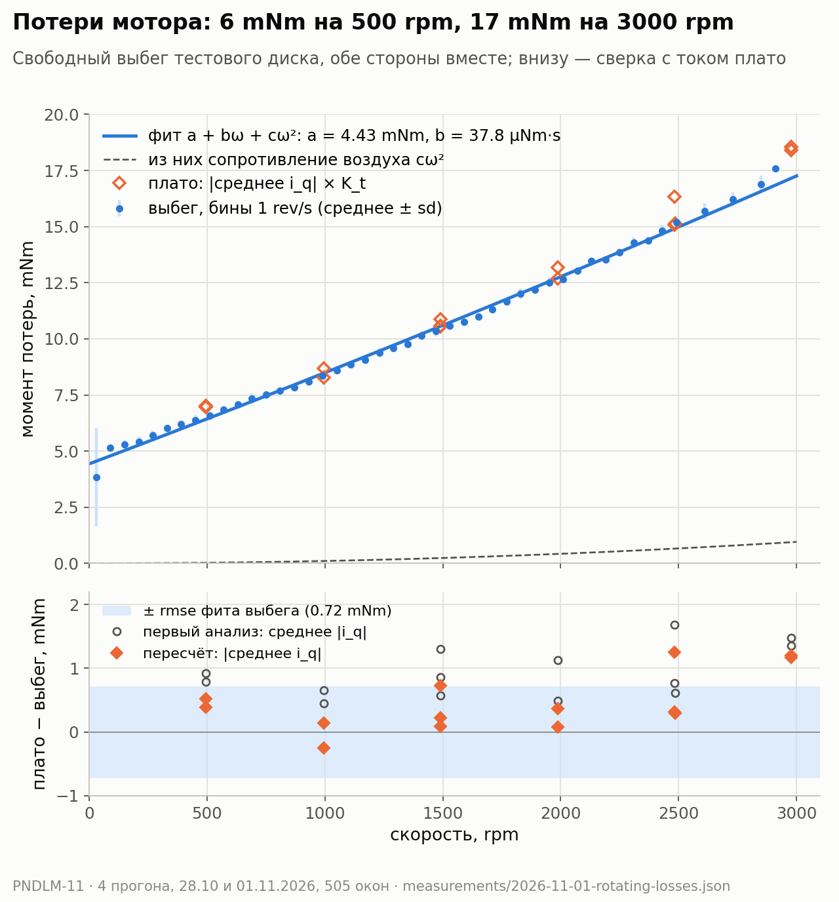

# Сколько момента мотор тратит сам на себя

## 0. Аннотация

Маховик держит маятник, потому что мотор его разгоняет и тормозит. Часть
момента мотор тратит не на маховик, а на собственные потери: трение в
подшипниках, магнитные потери в железе, сопротивление воздуха. Симулятор
до сих пор считал, что потерь нет.

Вопрос этой статьи: сколько момента теряется на разных скоростях, и какая
на самом деле инерция у всего, что вращается?

Ответ:

- Потери: 6.4 mNm на 500 rpm, 10.6 на 1500, 17.3 на 3000 rpm.
- Полная инерция вращения на 6.8 % больше, чем у одного диска: ротор мотора
  добавляет около 0.000024 kg·m².
- Для удержания маятника эти потери почти ничего не меняют. Проект можно
  продолжать.

По дороге нашлась ошибка в нашем же анализе. Она создала расхождение двух
методов на 4–14 %, которого на самом деле почти нет.

## 1. Вход: что у нас было

- Мотор mjbots mj5208, драйвер moteus r4.11. Хост — ноутбук, связь через
  USB-адаптер fdcanusb и шину CAN-FD.
- Константа момента из прошлого опыта (PNDLM-9): K_t = 0.0244 Nm/A.
  Измерена на заторможенном роторе, весами.
- Расчёт Phase 0. Phase 0 — первый этап проекта: до сборки железа
  проверить расчётом и симуляцией, что мотор и драйвер могут удержать
  маятник. Правило этапа — «честная симуляция»: в модели должны быть
  настоящие пределы мотора, в том числе трение.
- В симуляторе (`software/sim`) и в среде для обучения (`software/rl`)
  трения не было. В RL-среде стоит `b = 0.0`.

Чего не было: ни одного числа о потерях мотора и ни одного измерения
инерции ротора.

## 2. Мотивация: что такое потери и инерция и зачем их мерить

**Момент потерь.** Если мотор выключить, маховик не крутится вечно. Его
тормозит момент потерь τ_loss. Обычно его описывают тремя слагаемыми:

$$
\tau_{loss}(\omega) = a + b\,\omega + c\,\omega^2 .
$$

- ω — скорость вращения, rad/s.
- a — сухое трение (трение Кулона), Nm. Не зависит от скорости. Обычно это
  подшипники и магнитное «залипание».
- b — вязкое трение, Nm·s. Растёт со скоростью. Обычно это вихревые токи
  в железе статора и смазка подшипников.
- c — сопротивление воздуха, Nm·s². Растёт как квадрат скорости.

Это обычное толкование слагаемых. Опыт его не проверяет: мы измеряем
сумму, а не отдельные источники.

**Инерция.** Момент инерции I говорит, какой момент нужен, чтобы разогнать
тело:

$$
\tau = I \, \alpha ,
$$

где α — угловое ускорение, rad/s². Вращается не только маховик, но и
ротор мотора: колокол с магнитами. Его инерцию производитель не указывает.

**Почему это важно.** Регулятор маятника видит маховик как «рычаг»:
момент на маховике толкает корпус в обратную сторону. Если в модели нет
потерь, регулятор и нейросеть учатся на мотор без трения. Если инерция
неверна, неверен весь баланс моментов. Ещё один вопрос — остановка маховика.
Регулятор должен не только держать маятник, но и гасить скорость маховика.
Трение около нулевой скорости может мешать этому.

Цель опыта: измерить потери в зависимости от скорости в обе стороны
вращения, инерцию всей вращающейся части и погрешность каждого числа.

## 3. Что сделали

**Тестовый диск.** Маховик для маятника ещё не напечатан. Для опыта сделали
отдельный диск:

- Ø150 мм, PLA, 100 % заполнение, масса в основном в ободе;
- три спицы, скругления на всех переходах;
- крепление на ротор тремя винтами M3 × 8 с фиксатором резьбы;
- масса после печати 93.9 г вместо 98.6 г по модели;
- расчёт на прочность при 3000 rpm: напряжение в ободе ≈ 0.7 MPa, запас
  не меньше 10×;
- запас энергии при 3000 rpm ≈ 19 J. Поэтому диск закрыт ограждением, а
  стенд перед 3000 rpm закрепили на рельсе.

Инерцию диска посчитали по модели и пересчитали на взвешенную массу:
0.0003536 kg·m² вместе с винтами.

**Питание.** Лабораторный блок 24 В / 5 А. Он не умеет принимать ток
обратно. Значит, мотор нельзя использовать как тормоз: энергия диска пошла
бы в блок питания. Поэтому каждая остановка — свободный выбег.

**Выбег (coast-down).** Основной метод. Для каждой скорости лестницы
(500, 1000, 1500, 2000, 2500, 3000 rpm):

1. Оператор подтверждает шаг.
2. Разгон в режиме скорости, момент не больше 0.10 Nm.
3. Плато: 3 с на постоянной скорости. Хост пишет ток.
4. Выбег: фазы мотора размыкаются, диск тормозится сам.
5. Выбег кончился, когда скорость 0.25 с подряд ниже 0.2 rev/s.

При разомкнутых фазах ток в обмотках не течёт. Поэтому мотор не тормозит
диск электрически. Остаются только потери: подшипники, железо, воздух.

Скорость на выбеге режем на окна по 0.25 с. В каждом окне прямая по
скорости даёт замедление α. Момент потерь в окне:

$$
\tau_{loss} = I \cdot |\alpha| .
$$

Все окна всех прогонов вместе дают одну зависимость τ_loss(ω). По ней
методом наименьших квадратов строим фит a + bω + cω².

**Плато как проверка.** На плато скорость постоянна. Значит, мотор отдаёт
ровно столько момента, сколько съедают потери. Этот момент равен
K_t · I_q. Это второй, независимый способ измерить те же потери.

**Разгон ступенью момента (`--accelerate`).** Нужен для инерции. Диск
стоит. Команда момента сразу прыгает с нуля на 0.05, 0.10 или 0.15 Nm, в
обе стороны. Обратной связи нет (kp = kd = 0). Когда диск набирает
30 rev/s (1800 rpm), фазы размыкаются, начинается выбег.

На разгоне момент мотора идёт на ускорение и на потери. На выбеге только
потери тормозят диск. Сравним разгон и выбег на одной и той же скорости:

$$
K_t \, I_q = I\,|\alpha_{разгон}| + \tau_{loss}, \qquad
\tau_{loss} = I\,|\alpha_{выбег}|
$$

$$
\Rightarrow\; I = \frac{K_t \, I_q}{|\alpha_{разгон}| + |\alpha_{выбег}|} .
$$

Здесь модель потерь не нужна: выбег на той же скорости сам даёт потери.

**Меры безопасности.** Это ограничения в хосте и в драйвере. Если одно из
них срабатывает, опыт останавливается.

- **Пределы.** Хост останавливает опыт, если скорость выше 55 rev/s
  (3300 rpm). Ни одна команда не может быть больше 0.20 Nm.
- **Watchdog драйвера.** Это таймер в драйвере. Хост шлёт команду на каждом
  замере. Если новой команды нет 100 мс, срабатывает таймаут. Это значение
  `servo.default_timeout_s = 0.1` в конфигурации драйвера, и хост задаёт те
  же 0.10 с в каждой команде. Что драйвер делает по таймауту, задаёт
  параметр `servo.timeout_mode`. Значение — номер режима работы moteus:
  - 12 (zero velocity) — драйвер держит нулевую скорость, то есть активно
    тормозит. Так было настроено на нашем драйвере. Тормозной момент
    ограничен `servo.timeout_max_torque_Nm = 5`, это больше, чем мотор
    может дать. Энергия диска пошла бы в блок питания, который её не
    принимает;
  - 0 (stop) — драйвер снимает ток с фаз. Диск просто катится до
    остановки. Это значение ставим на время опыта и возвращаем после.
- **Flux brake с порогом 27 В.** Если напряжение шины растёт от
  рекуперации, энергия уходит в нагрев обмоток, а не в блок питания.
- **Срабатывание защиты не останавливает диск.** После него хост снимает
  ток и продолжает показывать скорость, пока диск не встанет. Аварийная
  остановка одна — отключить питание. Это тоже выбег.

**Примечание: что пришлось изменить по ходу.**

- Первые прогоны — на малых скоростях: 15/20/30 и 100/200/300 rpm. Так
  проверили сам порядок шагов.
- Ключ flux brake зависит от версии прошивки. На прошивке 2025 года это
  `servo.flux_brake_margin_voltage`.
- На малой скорости измерение скорости дрожит на ±0.05 rev/s. Поэтому конец
  выбега требует 0.25 с подряд ниже порога, а не одного замера.
- Включение драйвера из stop занимает ~15 мс (режимы 2–3). Это окно
  отсчитываем по времени от первой команды шага.
- 28.10 первый полный прогон дошёл до 1500 rpm. Перед 3000 rpm стенд
  закрепили на рельсе.

## 4. Что измерили

Пять прогонов, все без fault. Шина 24.2–24.3 В, контроллер 19–28 °C. Пик
тока 3.9 A на разгоне до 3000 rpm и 6.3 A на ступени 0.15 Nm. Выбег с
1500 rpm занимает 8.4 с, с 3000 rpm — 13 с.

| Прогон | Направление | Что |
|---|---|---|
| `20261028T191114Z` | +1 | лестница 500, 1000, 1500 rpm |
| `20261101T104259Z` | +1 | 1500, 2000, 2500 rpm |
| `20261101T104531Z` | +1 | 2500, 3000 rpm |
| `20261101T104928Z` | −1 | полная лестница 500–3000 rpm |
| `20261101T105228Z` | обе | ступени момента 0.05 / 0.10 / 0.15 Nm |

**Инерция**, прогон `20261101T105228Z`:

| Ступень, Nm | I, kg·m² | окон |
|---|---|---|
| +0.05 | 0.000387 | 9 |
| −0.05 | 0.000388 | 9 |
| +0.10 | 0.000383 | 4 |
| −0.10 | 0.000372 | 4 |
| +0.15 | 0.000364 | 3 |
| −0.15 | 0.000371 | 3 |

- **Полная инерция: 0.000378 ± 0.000010 kg·m².** Здесь ± — разброс шести
  проб, 2.6 %. Тренда по моменту и направлению нет.
- Это на 6.8 % больше диска с винтами (0.000354). Разница — 0.000024 kg·m²
  — это ротор и всё, что вращается вместе с ним. Насколько этому числу
  можно верить — в разделе 5.

**Потери**, 505 окон четырёх прогонов выбега, на полной инерции:

| Коэффициент | Значение | Стандартная ошибка |
|---|---|---|
| a, сухое трение | 4.43 mNm | ± 0.07 |
| b, вязкое трение | 37.8 µNm·s | ± 1.4 |
| c, воздух | 9.7 nNm·s² | ± 5.6 |

СКО отклонений окон от фита: 0.72 mNm.

| Скорость, rpm | Потери, mNm | Из них воздух, mNm |
|---|---|---|
| 500 | 6.4 | 0.03 |
| 1000 | 8.5 | 0.11 |
| 1500 | 10.6 | 0.24 |
| 2000 | 12.8 | 0.43 |
| 2500 | 15.0 | 0.66 |
| 3000 | 17.3 | 0.96 |

Как читать таблицы:

- Основная часть потерь — постоянная a и линейная b·ω. При 3000 rpm это
  4.4 + 11.9 mNm. Воздух даёт меньше 1 mNm.
- Направления +1 и −1 совпадают в пределах одной стандартной ошибки по
  всем трём коэффициентам. Модель симметричная.
- Погрешности — только статистические. Ошибка инерции 2.6 % сдвигает a, b
  и c вместе, в одну сторону. Её надо добавлять отдельно.
- c определён плохо: ошибка 58 % от значения. Для тестового диска это не
  важно, а на маховик Ø280 сопротивление воздуха этого диска всё равно не
  переносится.
- Ниже ~1 rev/s (60 rpm) данные шумные: sd 2.2 mNm в первом бине. Там
  выбег уже почти кончился, и окон мало.

**Что это заменяет.** Первый прогон 28.10 считали на инерции одного диска и
только до 1500 rpm: a = 3.8 mNm, b = 53 µNm·s, а c даже вышел
отрицательным. Короткий диапазон скоростей не разделяет b и c. Полная
лестница до 3000 rpm и правильная инерция дали числа выше.

## 5. Дополнительные вопросы

**Почему два метода сначала разошлись на 4–14 %?** Ток плато × K_t
получался на 4–14 % больше, чем потери по выбегу. Это около 1 mNm.
Сначала мы искали физику: K_t на скорости или смещение датчика тока. В
режиме stop драйвер показывает ток −1.2 A при разомкнутых фазах. Казалось,
что это смещение могло бы всё объяснить.

Причина оказалась проще. Анализ брал модуль тока на каждом замере и потом
усреднял: среднее |I_q|. Но ток на плато шумный. Пример, 500 rpm: среднее
0.29 A, sd 0.31 A. 13 % замеров имеют обратный знак. Модуль превращает эти
отрицательные замеры в положительные. Поэтому среднее модуля всегда больше
модуля среднего. Это не физика, это арифметика. Правильно — сначала
усреднить ток со знаком, потом взять модуль: |среднее I_q|.

После пересчёта по тем же логам:

- разрыв −2.9 … +8.3 %, в среднем 3.8 % (было 8.2 %);
- 11 шагов из 14 совпадают с выбегом в пределах 0.75 mNm. Это примерно
  СКО фита выбега;
- три шага на 2483–2978 rpm остаются выше на ~1.2 mNm. Причина не
  найдена. Кандидат — K_t на скорости: K_t мерили на неподвижном роторе.

Смещение −1.2 A исключено по двум причинам. 1 mNm разрыва — это всего
0.04 A при K_t = 0.0244 Nm/A, а 1.2 A дало бы ~29 mNm. Кроме того,
постоянное смещение тока дало бы разрыв с разным знаком в двух
направлениях. А разрыв в обоих направлениях положительный.

Ошибка исправлена в анализаторе стенда, добавлен тест. Старые значения
сохранены в записи измерений с пометкой `superseded`.

**Откуда мы знаем инерцию ротора?** Не из документации: производитель её
не даёт. Это разность двух чисел:

- полная инерция 0.0003776 kg·m² — измерена ступенями момента;
- инерция диска с винтами 0.0003536 kg·m² — рассчитана по модели и массе.

Разность 0.000024 kg·m² — ротор с магнитами и всё, что вращается вместе с
ним. Верить этому числу надо осторожно:

- Это разность двух больших близких чисел. Ошибка среднего по шести пробам
  ≈ 0.000004 kg·m², это уже ±17 % от разности.
- Каждый 1 % ошибки в K_t или в инерции диска сдвигает разность ещё на
  ~15 %. Полная инерция пропорциональна K_t.
- Инерция диска пересчитана на массу при одинаковой плотности. При 100 %
  заполнении это разумно, но не проверено.
- Грубая проверка не уверена: если ротор весит 60–80 г и его масса сидит на
  радиусе ~29 мм, тонкое кольцо дало бы 0.00005–0.00006 kg·m², в 2–3 раза
  больше. Массу ротора мы не знаем, поэтому это только порядок величины.

Для проекта это почти не важно. Даже 0.00006 kg·m² — около 2 % инерции
будущего маховика (0.00265 kg·m² по CAD). Для финального маховика лучше
снова сделать `--accelerate`, уже с ним. Тогда полная инерция измерится
сразу, без разделения на диск и ротор.

**Что происходит около нулевой скорости?** Сухое трение a меняет знак
вместе со скоростью. Около нуля это скачок: от −4.4 до +4.4 mNm. Мотор,
который даёт меньше 4.4 mNm, не сдвинет стоящий маховик. Это называют
мёртвой зоной. Если маховик то залипает, то срывается, это называют
stick-slip. Регулятор, который держит скорость маховика около нуля, в
теории может из-за этого раскачиваться.

Мы проверили это в симуляторе, а не на стенде. В модель добавили потери:

$$
\tau_{loss} = a \tanh(\omega_{rel}/\omega_s) + b\,\omega_{rel} + c\,\omega_{rel}|\omega_{rel}| ,
$$

где ω_rel — скорость маховика относительно корпуса маятника. tanh
сглаживает скачок трения на ширине ω_s. Потери действуют между ротором и
статором, поэтому тормозят маховик и с той же силой толкают корпус.

Проверка: LQR с тактом 500 Hz, задержка 5 мс, шум датчиков, номинальная и
худшая конструкция, последние 3 с из 10 с удержания.

- С шумом датчиков LQR выдаёт ~120 mNm rms момента. Это в 17 раз больше
  сухого трения даже в пессимистичном случае (7 mNm).
- Скорость маховика относительно корпуса меняет знак 75–105 раз в секунду.
  Маховик не стоит на месте, поэтому залипать ему некогда.
- Потери от нуля до 21 mNm (в 3 раза больше пессимистичного случая) меняют
  угол маятника меньше чем на 0.003° rms, а скорость маховика — меньше чем
  на 0.4 rpm rms.
- Без шума и с резким трением (ω_s = 0.05 rad/s) маховик остаётся на
  постоянной скорости 0.16 rpm при 7 mNm и 1.5 rpm при 21 mNm.
  Автоколебаний нет. У LQR нет интегратора, поэтому трение даёт только
  маленький постоянный сдвиг скорости.

Вывод: stick-slip не мешает ни удержанию, ни остановке маховика. Опыт с
моментом страгивания для Phase 0 не нужен. Не смоделирован случай, когда
момент страгивания выше уровня Кулона (эффект Штрибека).

**Что такое компенсация мёртвой зоны?** Регулятор может заранее добавить к
своей команде ожидаемое трение:

$$
\tau_{cmd} = \tau_{LQR} + a \cdot \mathrm{sign}(\omega) .
$$

Тогда мотор сам перекрывает трение. Риск: если a завышено, компенсация
сама раскачивает маховик около нуля. Поэтому берут гладкую форму (tanh) и
чуть меньше измеренного a. По результатам симуляции выше компенсация нам
пока не нужна.

**Изменится ли трение на финальной сборке?** Скорее всего, да. Сухое
трение зависит от натяга подшипников и от температуры, а опыт шёл только
при 19–28 °C на плате контроллера. Мерить это отдельно не будем. Вместо
этого приняли допущение: a = 3–7 mNm (номинал 4.4). Симуляция выше прошла и
при 21 mNm, поэтому точное значение a не нужно.

**Куда уходит энергия при торможении?** При 3000 rpm в диске
½ · I · ω² = 18.7 J. При активном торможении мотор возвращает эту энергию в
шину питания. Лабораторный блок её не принимает. На маятнике нужна
батарея, тормозной резистор или flux brake. Сами потери останавливают
диск за 13 с — для маятника это слишком медленно, но для стенда безопасно.

## 6. Результат и что это значит для проекта

- **В симулятор** (`software/sim`, блок `[losses]` в `phase0.toml`):
  - a = 4.43 mNm, диапазон 3–7 mNm;
  - b = 37.8 µNm·s, диапазон 35.5–40 µNm·s;
  - c — только для тестового диска, на маховик не переносится;
  - потери действуют между ротором и корпусом по относительной скорости;
  - выбор варианта: `phase0-control --losses none|low|nominal|high`.
- **Сравнение с бюджетом момента.** Длительный момент мотора — 0.29 Nm
  (PNDLM-9). Потери на 3000 rpm — 17 mNm, это 6 %. Около нуля, где
  работает маятник, потери 4–5 mNm, около 1.5 %.
- **Инерция ротора** ≈ 0.000024 kg·m², оценка разностью, точность
  примерно в 2 раза. Это ~1 % маховика. В модель пока не добавлена.
- **Вердикт:** проект можно продолжать. Потери известны с точностью
  около 3 %, оба направления совпадают, fault не было. С потерями до 21 mNm
  LQR держит маятник так же, как без них.
- **Не измерено:**
  - момент страгивания из покоя;
  - потери при другой температуре и на финальной сборке (вместо этого —
    допущение 3–7 mNm);
  - причина остаточного разрыва ~1.2 mNm на 2500–3000 rpm;
  - инерция ротора напрямую.
- **Что дальше:** перенести модель потерь и разброс a = 3–7 mNm в RL-среду
  `software/rl`. Сейчас нейросеть учится на моторе без трения.

## Графики

График строит `software/sim/app/plot_rotating_losses.py` (команда — в
docstring скрипта). Общий стиль и цвета — `software/sim/app/plot_style.py`:
синий и оранжевый — измерения, серый — модели и старые значения.

- **A. Момент потерь против скорости**
  (`figures/2026-11-01-rotating-losses.png`). Верхняя панель: потери по
  выбегу, бины по 1 rev/s (среднее ± sd, оба направления вместе); фит
  a + bω + cω²; отдельно его часть от сопротивления воздуха; ромбы — ток
  плато × K_t после пересчёта. Нижняя панель: разница «плато − выбег» на
  каждом шаге лестницы. Серые кружки — первый анализ (среднее |I_q|),
  оранжевые ромбы — пересчёт (|среднее I_q|), голубая полоса — ± СКО фита
  выбега. Данные:
  [2026-11-01-rotating-losses.json](../hardware/measurements/2026-11-01-rotating-losses.json),
  поля `loss_model` и `plateau_cross_check`.
