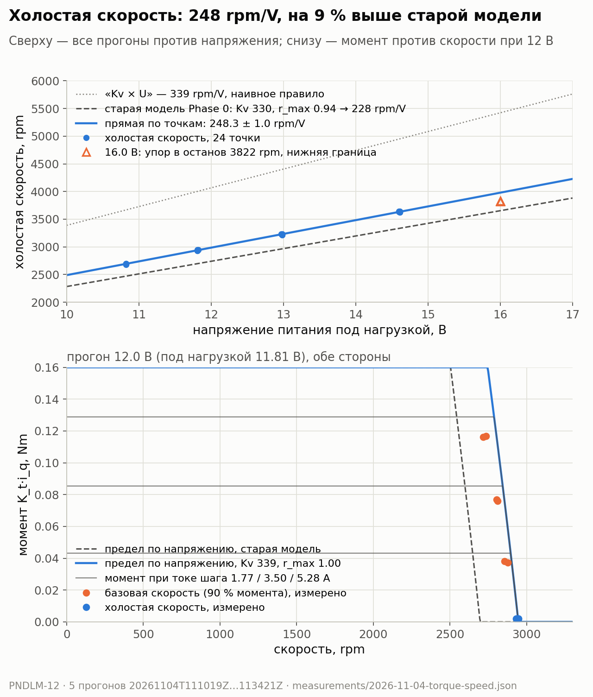
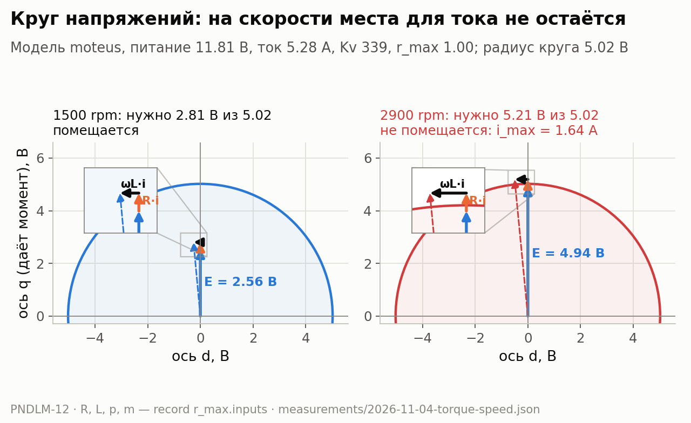

# Как быстро может крутиться маховик

## 0. Аннотация

Маховик удерживает маятник моментом. Но мотор даёт полный момент только до
определённой скорости. Выше неё момент падает. На холостой скорости
момент равен нулю.

Вопрос этой статьи: до какой скорости мотор развивает полный момент при разном
напряжении батареи? И верна ли модель, по которой симулятор считает этот
предел?

Ответ:

- Холостая скорость растёт на 248.3 ± 1.0 rpm на каждый вольт питания.
  Это на 9 % больше, чем считала старая модель (228 rpm/V).
- Модель контроллера moteus («круг напряжений») описывает данные. Её
  неизвестный параметр r_max = 1.00 ± 0.03.
- Kv мотора в конфигурации прошивки (296) неверен. Данные сходятся
  с Kv 339. Это число следует из константы момента, которую мы
  измерили раньше.
- Проект можно продолжать. Реальный мотор быстрее, чем считал симулятор.

## 1. Вход: что у нас было

- Мотор mjbots mj5208, драйвер moteus r4.11, тестовый диск Ø150 мм из
  прошлого опыта. Инерция и потери диска измерены (PNDLM-11).
- Константа момента K_t = 0.0244 Nm/A (PNDLM-9). Прошивка считает
  иначе: её K_t около 0.028 Nm/A, потому что в ней записан Kv 296.
- Модель предела по скорости в `software/sim/phase0.toml`: Kv 330 (по
  каталогу), r_max = 0.94. r_max был помечен как UNSURE (0.85–0.95).
- Расчёт Phase 0 давал 2740 rpm холостой скорости при 12 В. Гейт
  симулятора: при поимке маятника маховик не быстрее 70 % холостой
  скорости. Иначе для поимки не останется момента.

Чего не было: ни одного измерения момента на скорости.

## 2. Мотивация: почему мотор теряет момент на скорости

**Термины.** В статье четыре главных слова.

- *Напряжение питания* — постоянное напряжение на входе контроллера, от
  батареи или блока питания. Батарея 4S даёт от 12.0 В (разряжена) до
  16.8 В (заряжена).
- *Развиваемый момент* — момент, который мотор реально создаёт на валу.
- *Холостая скорость* — скорость, выше которой мотор не может разогнаться
  при данном напряжении. Момента на ней хватает только на собственные
  потери.
- *Базовая скорость* — скорость, выше которой мотор уже не развивает
  заданный момент. Мы считаем её там, где момент упал до 90 % от момента
  на низкой скорости.

Граница всех достижимых пар «скорость — момент» при данном напряжении —
это *предельная механическая характеристика* мотора.

**Мотор — это ещё и генератор.** Когда ротор крутится, магниты наводят в
обмотках напряжение. Оно называется противо-ЭДС, E. Оно растёт прямо
пропорционально скорости. Коэффициент — это Kv мотора, rpm на вольт.

**Контроллер делает переменное напряжение из постоянного.** Он быстро
переключает транзисторы (ШИМ). Амплитуда напряжения в фазе не может быть
больше половины напряжения питания. moteus ещё оставляет 15 % в запас.
Получается доступное напряжение:

$$
U_{max} = 0.5 \cdot U_{пит} \cdot r_{max} \cdot (1 - 0.15).
$$

r_max — доля, которую контроллер реально использует. Это единственное
неизвестное в модели.

**Чтобы прогнать ток, нужно напряжение.** Момент пропорционален току
i_q. Чтобы ток шёл, контроллер должен:

- перекрыть противо-ЭДС E;
- добавить падение на сопротивлении обмотки R·i;
- добавить падение на индуктивности ωL·i. Оно направлено под 90° к первым
  двум.

Эти три вектора складываются. Сумма должна поместиться в круг радиусом
U_max:

$$
(E + R\,i_q)^2 + (\omega L\,i_q)^2 \le U_{max}^2 .
$$

Это и есть «круг напряжений». Ту же формулу решает прошивка moteus.

На низкой скорости противо-ЭДС мала. Места в круге много, ток может быть
любым. С ростом скорости противо-ЭДС занимает почти весь круг. Места для
тока остаётся меньше, момент падает. Когда E равна радиусу, ток ноль. Это
холостая скорость.

На рисунке: при 12 В и 1500 rpm для тока 5.28 A нужно 2.81 В из 5.02.
При 2900 rpm нужно уже 5.21 В, и это не помещается. Контроллер может дать
только 1.64 A.

**Почему это важно.** При раскачке маятника маховик набирает скорость.
Чем ближе он к холостой скорости, тем меньше момента остаётся для поимки.
Если реальная холостая скорость ниже модели, стратегия раскачки в
симуляторе неверна. Если выше — у нас есть запас.

Цель опыта: измерить холостую скорость и базовую скорость при разном
напряжении питания и найти r_max.

## 3. Что сделали

**Питание.** Лабораторный блок с регулировкой напряжения, ограничение
тока не меньше 8 A. Блок не принимает ток обратно, поэтому мотор не
тормозит диск. Каждая остановка — свободный выбег, как в прошлом опыте.
Провода от блока до контроллера имеют около 0.1 Ом. Под нагрузкой
напряжение на контроллере на 0.2–0.6 В ниже установленного. Анализ
использует измеренное напряжение, а не установленное.

**Диск.** Тот же тестовый диск. Расчёт прочности расширили до 4000 rpm:
запас не меньше 10×, энергия ≈ 33 J. Диск закрыт ограждением, стенд
закреплён. Хост останавливает опыт на 3822 rpm (63.7 rev/s).

**Один прогон — одно напряжение.** Пять прогонов: 11.0, 12.0, 13.2, 14.8,
16.0 В. В каждом — шаги момента 0.05, 0.10, 0.15 Nm, в обе стороны.

Один шаг:

1. Оператор подтверждает шаг.
2. Контроллер получает постоянную команду момента с места.
3. Диск разгоняется. Шаг кончается, когда ускорение 0.5 с ниже 1 rev/s²
   (холостая скорость достигнута) или когда скорость дошла до останова.
4. Удержание 1 с на холостой скорости: пишем ток и напряжение.
5. Свободный выбег до остановки.

**Как считаем момент.** Датчика момента нет. Момент считаем по разгону:

$$
\tau(\omega) = I_{eff}\,\alpha(\omega) + \tau_{loss}(\omega).
$$

Инерцию I_eff и потери τ_loss берём из прошлого опыта (PNDLM-11).
Ускорение α считаем в окнах по 1.5 rev/s скорости.

**Как считаем r_max.** Kv берём из измеренной K_t:
Kv = 8.27 / 0.0244 = 339 rpm/V (±3 %). R = 0.0467 Ом и L = 44.8 мкГн —
из конфигурации контроллера. Тогда в круге одно неизвестное, r_max.
Подбираем его по 48 точкам: холостые скорости и базовые скорости всех
прогонов.

## 4. Что измерили

**Холостая скорость против напряжения** (верхняя панель графика):

| Прогон | Напряжение под нагрузкой | Холостая скорость, + / − |
|---:|---:|---:|
| 11.0 В | 10.82 В | 2691 / 2693 rpm |
| 12.0 В | 11.81 В | 2940 / 2941 rpm |
| 13.2 В | 12.98 В | 3225 / 3228 rpm |
| 14.8 В | 14.61 В | 3633 / 3634 rpm |
| 16.0 В | 15.4–16.3 В | ≥ 3822 rpm, упор в останов |

- Прямая по 24 точкам: 248.3 ± 1.0 rpm/V, свободный член 6 ± 12 rpm.
  Отклонение точек от прямой — 6.5 rpm rms.
- Обе стороны вращения: 248.2 и 248.3 rpm/V.
- Холостая скорость не зависит от команды момента. При 12 В шаги 0.05,
  0.10 и 0.15 Nm дали 2932–2947 rpm.

**r_max.** С Kv 339: r_max = 0.996 ± 0.029. Почти вся погрешность — от
±3 % в K_t. Разброс самих точек — 0.001. По холостым точкам 1.003, по
базовым скоростям 0.989. С Kv 296 из конфигурации прошивки нужен
r_max = 1.137.

**Базовая скорость.** На сколько rpm она ниже холостой скорости, 8 точек
на шаг (4 напряжения × 2 стороны):

| Команда | Развиваемый момент | Ток | Базовая скорость ниже холостой |
|---:|---:|---:|---:|
| 0.05 Nm | 0.041–0.043 Nm | 1.7–1.8 A | 54–89 rpm, среднее ≈ 70 |
| 0.10 Nm | 0.084–0.086 Nm | 3.5 A | 116–155 rpm, среднее ≈ 133 |
| 0.15 Nm | 0.129–0.131 Nm | 5.2–5.4 A | 189–248 rpm, среднее ≈ 217 |

Погрешность одной базовой скорости — 28–92 rpm.

**Условия.** Fault не было. Контроллер 19–27 °C. Пик тока 7.2 A.

## 5. Дополнительные вопросы

**Почему 248 rpm/V, а не 339?** Kv 339 относится к напряжению на
обмотке, а не к напряжению питания. До обмотки доходит только часть:

- 0.5 — амплитуда в фазе равна половине питания;
- 0.85 — 15 % moteus держит в запасе;
- √3 — из определения Kv через линейное напряжение.

339 · 0.5 · 0.85 · √3 ≈ 249.5 rpm/V. Это совпадает с измеренными 248.3 в
пределах погрешности K_t.

Отсюда простое правило «скорость = Kv × напряжение» (339 rpm/V) завышает
холостую скорость на 37 %. На графике это серая пунктирная линия.

**Холостая скорость — это потолок?** Да, при данном напряжении. Ротор
разгоняется, противо-ЭДС растёт. Когда она заполняет круг, ток кончается,
и разгон останавливается. Поднимается напряжение — растёт круг, и
холостая скорость растёт вместе с ним.

**Меняется ли Kv с напряжением?** Нет. Kv задают магниты и обмотка. Это
видно по данным: точки лежат на прямой, без изгиба, на 10.8–14.6 В.
Свободный член совпадает с нулём. Если бы Kv менялся, прямая бы
изгибалась.

Что может менять Kv:

- *Температура магнитов.* У магнитов NdFeB поле слабеет примерно на 0.1 %
  на каждый градус. Горячий мотор чуть быстрее и чуть слабее. Это общее
  свойство магнитов, в этом опыте не проверено. Температуру мотора мы не
  писали, только контроллера.
- *Большой ток.* Железо насыщается, и K_t падает. Это влияет на момент,
  а не на холостую скорость. Наши шаги были до 5.3 A, так что здесь это
  не проверено.

**Почему Kv в конфигурации прошивки неверен?** С Kv 296 данным нужен
r_max = 1.14.
Это больше 100 % напряжения питания, так быть не может. Значит, реальный
Kv выше. Kv 339 из измеренной K_t даёт r_max = 1.00. Это та же история,
что в статье о K_t: прошивка завышает K_t примерно на 15 %. Развиваемый
момент — 0.041 / 0.085 / 0.129 Nm при команде 0.05 / 0.10 / 0.15 Nm.

**Совпадает ли форма предельной характеристики?** Холостая скорость
совпадает с моделью лучше 1 %. Но момент начинает падать чуть раньше,
чем у идеального круга. На нижней панели графика оранжевые точки лежат
левее синей линии модели. Пример, 14.8 В и шаг 0.15 Nm: на измеренной
базовой скорости модель разрешает 5.11 A, а измерено 3.63 A. Так во всех
12 шагах в положительную сторону, которые мы сравнили. Причину мы не
искали. Кандидат — регулятор тока контроллера вблизи предела.

**Что значит «fault code 98»?** В регистре fault moteus код 98 появлялся
сотни раз за прогон. Это не авария. Коды 96–103 в рабочем режиме значат
«сейчас работает ограничение», здесь — по напряжению питания. Это и есть
круг напряжений в действии. Хост теперь останавливается только при
настоящем fault.

**Почему верхний шаг 0.15, а не 0.18 Nm?** Шаг 0.18 Nm при 11 В сработал
на предел безопасности 0.20 Nm. Ток шумит, и один замер дал 0.202 Nm при
7.2 A. Шаг убрали, 0.15 Nm даёт пик 0.18 Nm с запасом.

**Почему нет 16.8 В?** Уже при 16.0 В все шаги упёрлись в останов
3822 rpm. При 16.8 В было бы то же. Прямая даёт около 4170 rpm при
16.8 В на контроллере. Это выше паспорта диска (4000 rpm), поэтому
проверять не стали. Точку можно подтвердить позже от батареи 4S.

## 6. Результат и что это значит для проекта

- **В симулятор** (`phase0.toml`, задача PNDLM-14):
  - Kv = 339 вместо 330;
  - r_max = 1.0 вместо 0.94;
  - проверка: 248.3 rpm/V холостой скорости.
- **Запас по скорости.** Холостая скорость на 9 % выше старой модели: при
  12 В около 2990 rpm вместо 2740. Значит, маховик дальше от предела 70 %.
  Грубая оценка: прямой подъём при 12 В в расчёте Phase 0 занимал 71–79 %
  холостой скорости. С новой моделью это около 65–73 %. Точные числа даст
  перерасчёт в PNDLM-14.
- **Вердикт:** проект можно продолжать. Модель контроллера подтверждена,
  её параметр измерен с точностью 3 %, обе стороны совпадают, fault не
  было.
- **Не измерено:**
  - большой ток. Опыт шёл до 5.3 A (0.13 Nm). Поимка маятника требует
    до 1.7 Nm, это около 70 A. Тогда R·i ≈ 3.3 В — две трети круга при
    12 В. При таком токе форму предела задают R и L. Их мы взяли из
    конфигурации контроллера, а не измеряли;
  - причина раннего спада момента у базовой скорости;
  - точка 16.8 В и температура мотора.

## Графики

Графики строит `software/sim/app/plot_torque_speed.py` (команда — в
docstring скрипта). Общий стиль и цвета — `software/sim/app/plot_style.py`:
синий и оранжевый — измерения, серый — модели и старые значения.

- **A. Холостая скорость и предельная характеристика**
  (`figures/2026-11-04-torque-speed.png`). Верхняя панель: холостая
  скорость каждого шага против напряжения под нагрузкой; прямая по
  точкам; старая модель (Kv 330, r_max 0.94); правило «Kv × U»;
  треугольники — прогон 16.0 В, нижняя граница. Нижняя панель: прогон
  12.0 В. Предел по напряжению для новой и старой модели; момент при токе
  каждого шага; измеренные базовые скорости (при 90 % момента) и
  холостые скорости. Данные:
  [2026-11-04-torque-speed.json](../hardware/measurements/2026-11-04-torque-speed.json),
  поля `runs[].steps` и `no_load_line`.
- **B. Круг напряжений** (`figures/2026-11-04-voltage-circle.png`).
  Модель moteus при 11.81 В и 5.28 A: противо-ЭДС, R·i и ωL·i при 1500 и
  2900 rpm, с увеличением конца вектора. Параметры — поле
  `r_max.inputs` той же записи.
