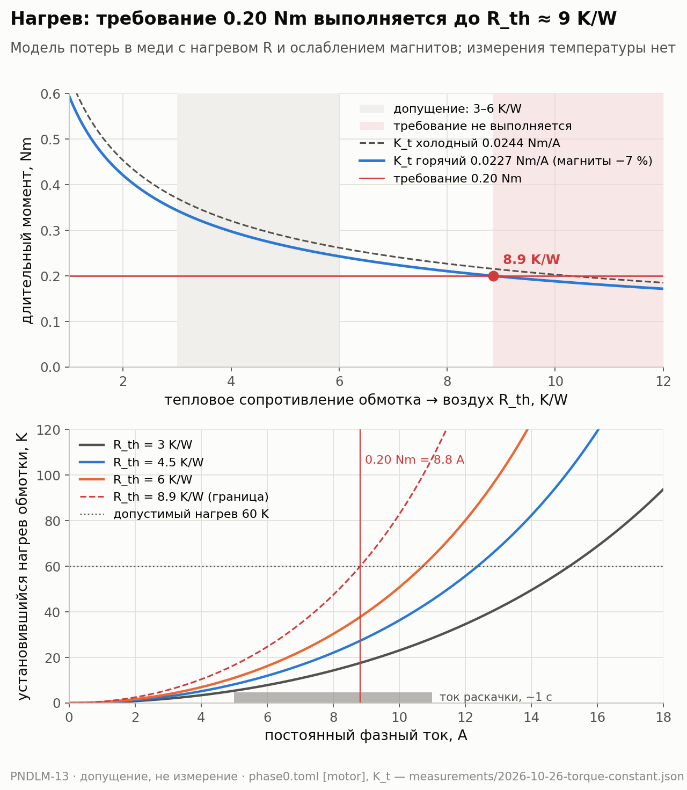

# Почему мы не меряли нагрев мотора

## 0. Аннотация

Мотор нагревается от тока. Горячий мотор слабее: растёт сопротивление
обмотки, слабеют магниты. Если мотор перегреть, он может испортиться.
По плану проекта нужно было измерить, какой момент мотор может развивать
долго, без перегрева.

Датчика температуры у нас нет: в mj5208 нет термистора. Вопрос этой
статьи: можно ли заменить измерение влияния нагрева допущениями? Какие
параметры зависят от температуры и в каких пределах?

Ответ:

- По требованию проекта мотор должен развивать 0.20 Nm сколь угодно
  долго. Модель даёт 0.24–0.35 Nm даже с горячей обмоткой и
  ослабленными магнитами.
- Требование нарушится, только если тепловое сопротивление мотора больше
  8.9 K/W. Допущение — 3–6 K/W, запас в 1.5 раза по худшему значению.
- Горячий мотор (+60 K): сопротивление +24 %, K_t −6…−7 %, Kv +6…+8 %.
  Все проверки Phase 0 всё равно выполняются.
- Для Phase 0 этого достаточно. Опыт заменён допущением, задача закрыта.

## 1. Вход: что у нас было

- Мотор mjbots mj5208, драйвер moteus r4.11. Термистора в моторе нет, канал
  температуры мотора в драйвере выключен
  (`servo.enable_motor_temperature 0`).
- K_t = 0.0244 Nm/A на холодном моторе (PNDLM-9). Kv = 339 rpm/V
  (PNDLM-12). Сопротивление фазы R = 0.047 Ом из калибровки драйвера.
- Тепловая модель в `software/sim/phase0.toml`, помечена UNSURE:
  - потери в меди P = 1.5 · I² · R;
  - тепловое сопротивление обмотка → воздух 3 / 4.5 / 6 K/W, мотор 63 мм
    без обдува;
  - допустимый нагрев обмотки 60 K.
- Требование Phase 0: мотор должен развивать 0.20 Nm сколь угодно долго
  при неподвижном роторе и без обдува.
- План опыта (PNDLM-13): закрепить ротор и по очереди подавать несколько
  постоянных токов. На каждом токе мерить температуру обмотки, пока она
  не перестанет расти. Нужен датчик
  температуры и упор, рассчитанный на этот момент.

## 2. Мотивация: что меняется, когда мотор греется

**Тепловое сопротивление.** Ток греет обмотку. Мощность нагрева —
потери в меди P, в ваттах. Тепло уходит в воздух и в детали, к которым
прикручен мотор. Через какое-то время температура перестаёт расти: тепло
уходит так же быстро, как появляется. Тогда

$$
\Delta T = R_{th} \cdot P .
$$

- ΔT — на сколько обмотка горячее воздуха, K. 1 K — то же, что 1 °C
  разницы.
- R_th — тепловое сопротивление, K/W. Сколько кельвинов нагрева даёт
  каждый ватт. Зависит от размера мотора, обдува и крепления.

Это та же форма, что закон Ома U = R · I. Поток тепла — как ток, разница
температур — как напряжение.

Пример: R_th = 5 K/W и 4 W потерь. Обмотка нагреется на 20 K выше
воздуха.

**Что зависит от температуры.**

- *Сопротивление обмотки.* У меди +0.393 % на каждый кельвин. Горячая
  обмотка греется ещё сильнее при том же токе: потери растут вместе с R.
- *Магниты.* У магнитов NdFeB поле слабеет на 0.10–0.12 % на кельвин.
  Падает K_t: на тот же ток мотор даёт меньше момента. Растёт Kv: мотор
  быстрее на холостом ходу.
- *Потери в подшипниках.* Тёплая смазка жиже, трение меньше.
- *Индуктивность* почти не меняется.

**Почему это важно.** Маятник держится моментом. Если долгий момент
нагреет мотор выше допустимого, придётся снижать ток. Тогда маятник
упадёт. Если перегреть магниты, они могут ослабеть навсегда.

## 3. Что сделали

Опыт не ставили. Вместо него — расчёт по модели из `phase0.toml` с двумя
поправками на температуру. Модель проверяем на краях: обмотка на 60 K
горячее воздуха (допустимый предел), магниты нагреты так же.

Магниты в моторе с внешним ротором сидят на роторе и обычно холоднее
обмотки. Поэтому нагрев магнитов на те же 60 K — худший случай.

**Длительный ток.** В установившемся режиме ΔT = R_th · 1.5 · I² · R₀ · (1 + 0.00393 · ΔT).
При ΔT = 60 K отсюда:

$$
I_{cont} = \sqrt{\frac{60}{R_{th} \cdot 1.5 \cdot R_0 \cdot 1.236}} .
$$

Множитель 1.236 — это сопротивление горячей обмотки, +23.6 %.

**Длительный момент** = I_cont × K_t горячий. K_t горячий =
0.0244 × (1 − 0.0012 × 60) = 0.0227 Nm/A, худший случай.

**Граница.** Сколько тока нужно на 0.20 Nm при горячем K_t, сколько это
даёт потерь, и при каком R_th нагрев ровно 60 K.

Все числа печатает `software/sim/app/plot_thermal.py`.

## 4. Что получили (расчёт, не измерение)

**Параметры на краях** (воздух ~20 °C, обмотка ~80 °C):

| Параметр | Холодный | Горячий (+60 K) | Изменение |
|---|---:|---:|---:|
| Сопротивление фазы R | 0.047 Ом | 0.058 Ом | +23.6 % |
| K_t | 0.0244 Nm/A | 0.0227–0.0230 Nm/A | −6…−7 % |
| Kv | 339 rpm/V | 361–365 rpm/V | +6…+8 % |
| Холостая скорость | 248 rpm/V | 264–268 rpm/V | +6…+8 % |

**Длительный ток и момент**, нагрев 60 K:

| R_th | Длительный ток | Момент, K_t горячий | Момент, K_t холодный |
|---:|---:|---:|---:|
| 3 K/W | 15.2 A | 0.34–0.35 Nm | 0.37 Nm |
| 4.5 K/W | 12.4 A | 0.28 Nm | 0.30 Nm |
| 6 K/W | 10.7 A | 0.24–0.25 Nm | 0.26 Nm |
| 8.9 K/W | 8.8 A | 0.20 Nm | 0.22 Nm |

**Граница.** 0.20 Nm при K_t 0.0227 — это 8.8 A. Потери при горячей
обмотке — 6.8 W. 60 K / 6.8 W = **8.9 K/W**.

**Нагрев, если мотор долго развивает 0.20 Nm** (8.8 A): 18 K при 3 K/W, 27 K при 4.5,
38 K при 6. Предел 60 K.

Прошлый расчёт Phase 0 давал 12–17 A длительного тока. Он не учитывал
рост сопротивления с температурой. С ним получается 10.7–15.2 A.

## 5. Дополнительные вопросы

**Что значит «8.9 K/W»?** Это самое большое тепловое сопротивление, при
котором мотор развивает 0.20 Nm сколь угодно долго и не греется выше 60 K.
Если реальный мотор отдаёт тепло лучше (R_th меньше), запас есть. Если
хуже — нет. Мы не знаем реального R_th. Но допущение 3–6 K/W в 1.5 раза
ниже границы. Колесо, прикрученное к ротору, работает как радиатор,
поэтому на сборке R_th скорее меньше допущения.

**Как быстро мотор греется?** R_th говорит только, до какой температуры.
Скорость задаёт теплоёмкость C, J/K. Постоянная времени τ = R_th · C.
Оценка: мотор 193 г, теплоёмкость металлов ~500 J/(kg·K), C ≈ 100 J/K.
Тогда τ ≈ 300–600 с, то есть 5–10 минут. Это оценка, не измерение.

Поэтому короткие события мотор почти не греют. Раскачка маятника — ток
5–11 A около 1 с. При 11 A потери ~8.5 W, за секунду это ~8.5 J, нагрев
меньше 0.1 K.

**Сколько момента нужно на самом деле?** Уравновешенный маятник в
среднем почти не требует момента. Регулятор отрабатывает толчки и
поправки. Требование 0.20 Nm без ограничения по времени — это запас на случай постоянной нагрузки:
трение, залипание, наклон основания. Средний ток при удержании, скорее
всего, намного меньше 8.8 A. Это предположение, его проверит сборка.

**Что будет с магнитами?** Это главный открытый риск. Марку магнитов
mj5208 мы не знаем. Обычные магниты марки N теряют поле навсегда выше
~80 °C. Нагрев 60 K от комнаты в 20 °C — это как раз 80 °C. Поэтому 60 K
надо считать жёстким пределом, а не поднимать его. Летом при 30 °C в
комнате предел нагрева меньше.

**Защищён ли драйвер?** Да. Драйвер меряет свою температуру сам. В
конфигурации `servo.fault_temperature 75` и `servo.temperature_margin 25`:
снижение тока начинается с 50 °C, авария — на 75 °C. В опыте torque-speed
драйвер был 19–27 °C при токе до 7 A. Паспорт r4.11 — 12 A длительно без
радиатора. Это тот же диапазон, что у мотора.

**Меняет ли нагрев круг напряжений?** При малом токе — почти нет. При
большом — да. На пиковом моменте 1.7 Nm ток около 70 A. Падение R·i
растёт с 3.3 до 4.1 В при радиусе круга около 5.1 В на 12 В. Горячий мотор
теряет большую часть скорости на полном моменте. Это важно, только если
прямой подъём маятника начинается с горячим мотором. Раскачка с
ограничением момента почти не меняется.

**Пиковые запасы.** K_t −7 % снижает запас по пиковому моменту с 7.3× до
~6.8× (толчок пальцем, 10°) и с 3.7× до ~3.4× (20°). Оба проходят.

**Можно ли измерить без датчика?** Да, через сопротивление. Медь — сама
термометр. Держим постоянный ток на заторможенном роторе, пишем
напряжение и ток, считаем R. Тогда ΔT = ΔR / (R₀ · 0.00393). Мы не
проверяли, достаточно ли точна телеметрия moteus для этого. Другой
вариант — термопара на статоре за ~10 €.

## 6. Результат и что это значит для проекта

- **Решение:** PNDLM-13 закрыт допущением, без опыта. Для проверки
  Phase 0 запас достаточен.
- **Допущение** (в
  [phase-0-feasibility.md](../physics/phase-0-feasibility.md#continuous-thermal-gate)):
  - R_th = 3–6 K/W, граница 8.9 K/W;
  - нагрев обмотки не больше 60 K, жёсткий предел;
  - горячий край: R +24 %, K_t −7 %, Kv +8 %;
  - длительный момент 0.24–0.35 Nm при требовании 0.20 Nm.
- **Не измерено:**
  - реальное R_th на сборке с колесом;
  - тепловая постоянная времени;
  - марка магнитов и их предельная температура;
  - средний ток при удержании маятника.
- **Что дальше:** горячий край можно добавить в симулятор как отдельный
  набор параметров. Термопару или замер по сопротивлению стоит сделать на
  финальной сборке, когда будет известен реальный средний ток.

## Графики

График строит `software/sim/app/plot_thermal.py` (команда — в docstring
скрипта). Общий стиль и цвета — `software/sim/app/plot_style.py`: синий и
оранжевый — расчёт с измеренными K_t и R, серый — допущения и старые
значения, красный — область, где требование не выполняется.

- **A. Длительный момент и нагрев**
  (`figures/2026-11-09-thermal-assumption.png`). Верхняя панель:
  длительный момент при нагреве 60 K против R_th, с горячим и холодным
  K_t; серая полоса — допущение 3–6 K/W; красная — R_th больше границы
  8.9 K/W. Нижняя панель: установившийся нагрев обмотки против
  длительного тока для R_th 3, 4.5, 6 и 8.9 K/W; линия 60 K; ток 8.8 A
  для 0.20 Nm; серая полоса — ток раскачки (короткое событие, нагрев не
  успевает установиться). Данные: `software/sim/phase0.toml` блок `[motor]`, K_t —
  [2026-10-26-torque-constant.json](../hardware/measurements/2026-10-26-torque-constant.json),
  поле `simulator.kt_linear_region_per_commanded_a_nm_per_a`.
