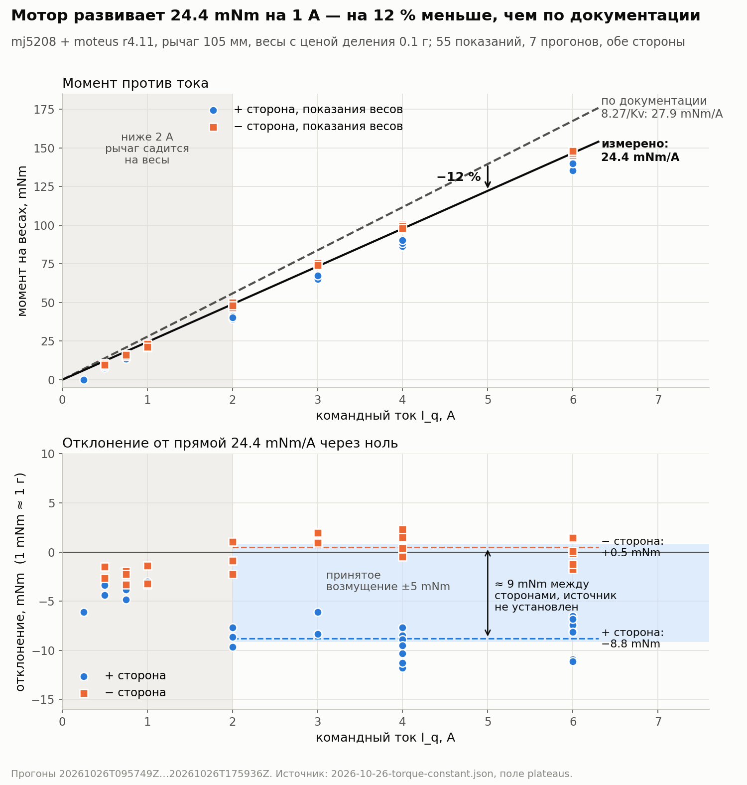
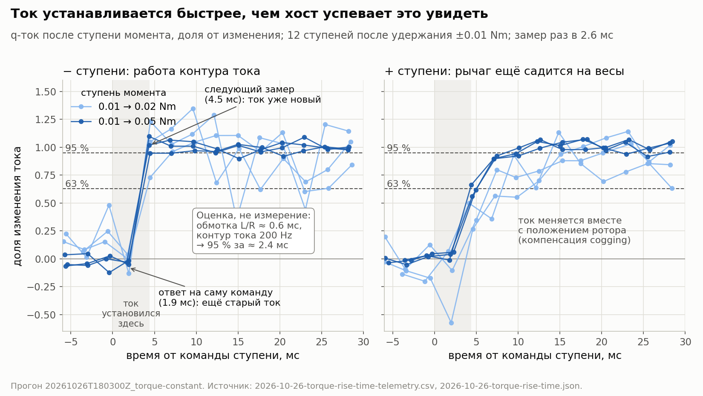

# Черновик: «Какой момент развивает мотор на 1 A»

Статус: черновик статьи. Не опубликовано. Площадка: не Telegram-пост
(длинный текст; Telegraph или блог — решить при публикации).
Данные: [спецификация стенда, §9–10](../hardware/specs/motor-torque-fixture.md),
[2026-10-26-torque-constant.json](../hardware/measurements/2026-10-26-torque-constant.json),
[2026-10-26-torque-rise-time.json](../hardware/measurements/2026-10-26-torque-rise-time.json),
[запас по моменту (Phase 0)](../physics/phase-0-feasibility.md),
[PNDLM-9](https://zjor.youtrack.cloud/issue/PNDLM-9),
связанный опыт — [PNDLM-8](https://zjor.youtrack.cloud/issue/PNDLM-8)
([статья о задержке](2026-11-08-response-delay-draft.md)).
Конфигурация драйвера: `controller-config.txt` прогона
`20261026T180300Z_torque-constant` (локальный лог, не в git; хеш в JSON).
График: `figures/2026-10-26-torque-constant.png`; строит
`software/sim/app/plot_torque_constant.py` (команда — в docstring скрипта).

## 0. Аннотация

Маховик создаёт момент, который удерживает маятник в равновесии.
Регулятор вычисляет нужный момент в Nm, а драйвер мотора выставляет ток.
Связь между ними — одно число, константа момента K_t.

Вопрос этой статьи: какой момент развивает мотор mj5208 на 1 A и с какой
погрешностью известна эта величина?

Ответ: K_t = 0.0244 ± 0.0005 Nm/A. Это 87.6 % от значения по документации
драйвера. Момент нарастает быстрее, чем хост успевает это увидеть:
не дольше 4.4 мс. Запас по моменту для проекта сохраняется.

## 1. Вход: что у нас было

- Мотор mjbots mj5208, драйвер moteus r4.11. Хост — ноутбук, связь через
  USB-адаптер fdcanusb и шину CAN-FD.
- Константа момента согласно документации moteus: K_t = 8.27 / Kv. Kv
  драйвер определил при калибровке: 296.35 rpm/V. Отсюда
  K_t = 0.0279 Nm/A. Дальше это значение называется «K_t по документации».
- Плановое значение в расчёте Phase 0: 0.0251 Nm/A. Phase 0 — первый этап
  проекта: до сборки железа расчётом и симуляцией проверить, что мотор и
  драйвер могут удержать маятник.
- Требования Phase 0 к моменту: длительный момент ≥ 0.20 Nm, удержание
  наклона 20° — 0.33 Nm, пик 1.7 Nm.
- Из прошлого опыта (PNDLM-8): при команде 0.02 Nm ток был на 20–40 % ниже
  ожидаемого. Причина была не ясна.

Чего не было: независимого измерения момента на валу.

## 2. Мотивация: что такое K_t и почему его надо измерять

**Константа момента.** Мотор превращает ток в момент на валу:

$$
\tau = K_t \, I_q .
$$

- τ — момент на валу, Nm.
- I_q — ток, который создаёт момент (см. ниже), A.
- K_t — константа момента, Nm/A. Пример: при K_t = 0.0244 Nm/A ток 10 A
  даёт 0.244 Nm.

K_t связана с Kv — скоростной константой мотора (обороты в минуту на
вольт). Чем больше Kv, тем меньше K_t. Для идеального мотора
K_t = 60 / (2π · Kv) ≈ 9.55 / Kv. Прошивка moteus использует 8.27 / Kv.
8.27 ≈ 9.55 · √3/2; этот множитель связан с тем, как прошивка определяет
ток.

**Ток q.** Драйвер управляет мотором методом векторного управления (FOC).
Он пересчитывает три фазных тока в две составляющие в системе координат,
которая вращается вместе с ротором:

- d — вдоль поля магнитов ротора. Эта составляющая момента не создаёт.
- q — поперёк поля. Только она создаёт момент.

Драйвер держит I_d = 0 и регулирует I_q. Поэтому «ток» в этой статье —
всегда I_q.

**Почему K_t важна.** Регулятор просит момент T. Драйвер делит T на свою
K_t и выставляет ток. Если настоящая K_t меньше, чем K_t по документации, мотор отдаёт
меньше момента, чем просили. Симулятор с неверной K_t обучит регулятор и
нейросеть на более сильном моторе, чем есть на самом деле.

Момент, который сообщает драйвер, для проверки не подходит. Драйвер
вычисляет его из тока через ту же K_t, которую мы проверяем. Нужна
независимая опора — весы.

Цель опыта: измерить K_t в обе стороны вращения, в том числе при малом
токе 0.5–1 A, где работает маятник около вертикали. Попутно измерить, как
быстро ток достигает заданного значения.

## 3. Что сделали

**Стенд.** Мотор закреплён на плите. На роторе — уравновешенный
H-образный рычаг. Конец рычага давит на весы. Плечо — расстояние от оси
мотора до точки контакта — 105 мм. Весы рассчитаны на 3 кг, цена деления
0.1 г. С другой стороны стоит жёсткий упор: он не даёт рычагу уйти, если
контакт с весами потерян.

Момент считаем по показаниям весов:

$$
\tau = m \, g \, r ,
$$

где m — показания весов, g = 9.80665 m/s², r = 0.105 m. Одно деление весов
0.1 г соответствует 0.1 mNm. Весы проверены монетами 3.6–9.7 г: показания
совпадают в пределах 0.1 г.

**Плато тока.** Хост задаёт постоянный ток и держит его 3 с. Это плато.

- Уровни: 0.25, 0.5, 0.75, 1, 2, 3, 4, 6 A, в обе стороны.
- Ток растёт от нуля до цели за 0.25 с. Мгновенная ступень 6 A сжала стенд
  на 0.3 мм за 6 мс, и сработал стоп по скорости.
- Первые 20 % плато не входят в анализ: там ток и рычаг ещё не
  установились.
- Между плато мотор стоит 5 с, чтобы обмотка остыла.
- Оператор смотрит на весы во время плато и вводит показание после него.
- Чтобы измерить другую сторону, весы переставляют под другой конец рычага
  и меняют знак тока.

**Как подаётся команда.** Плато идёт как команда положения с нулевыми
коэффициентами регулятора (kp = kd = 0) и моментом прямой подачи
(feedforward torque) = ток × 0.0279 Nm/A. Причина: в режиме прямого
задания тока у драйвера нет watchdog. Watchdog — таймер в драйвере: если
новая команда не пришла за 0.1 с, драйвер сам снимает момент. В режиме
положения он работает. Хост повторяет команду каждый замер.

**Защита стенда.** Стоп, если:

- скорость ротора выше 0.05 rev/s (0.15 rev/s в первые 0.3 с плато, пока
  рычаг садится на весы);
- ротор сместился больше чем на 0.01 rev от начала плато;
- измеренный ток выше 8.5 A;
- суммарный нагрев за сессию выше 2500 A²s (оценка по I²t);
- температура платы выше 65 °C. Термистора в моторе нет.

**Обработка.** Метод наименьших квадратов, прямая τ = K_t · I + b, для
каждой стороны отдельно. Две области:

- линейная область 2–6 A — основной результат;
- все точки 0.25–6 A — для сравнения.

Ток по оси X — командный, а не измеренный. Причина в разделе 5: к
команде драйвер добавляет ток компенсации cogging. Нас интересует, какой
момент даёт запрос, поэтому опора — команда. Для сравнения есть и прямая
по измеренному току.

**Время нарастания.** Отдельный режим. Рычаг лежит на весах, ротор
неподвижен. Хост держит 0.01 Nm 0.25 с (предварительное удержание), затем
даёт ступень до 0.02 или 0.05 Nm на 0.5 с. Опрос 400 Hz запрошен, 380 Hz
получен: разрешение 2.6 мс. Для каждой ступени: время до 63 % (t63) и до
95 % (t95) от изменения тока.

**Примечание: что пришлось изменить по ходу.**

- Режим прямого задания тока заменён командой положения (нет watchdog, см.
  выше).
- Команда 0 Nm не даёт нулевого момента: сразу после включения ток около
  −0.46 A на ~100 мс. Рычаг поднялся с весов на 7.7°. Причина — компенсация
  cogging (раздел 5). Поэтому нужен жёсткий упор, а плато 0 A пропускаем.
- Плато 8 A пропущено: при нагрузке около 216 г стенд начал подаваться,
  скорость ротора росла при постоянной команде.
- 4 из 7 прогонов закончились стопом защиты: опечатка оператора в знаке,
  два случая перестановки рычага рукой (до введения окна посадки), один
  рычаг не лёг на упор. Движения стенда под нагрузкой не было. Показания
  до стопа годны.

## 4. Что измерили

7 прогонов `20261026T…Z_torque-constant`, 59 плато, из них 55 с показанием
весов.

| Команда, A | + сторона, г | − сторона, г |
|---|---|---|
| 0.5 | 7.6–8.7 | 9.3–10.4 |
| 0.75 | 13.1–14.1 | 14.6–15.9 |
| 1 | 20.5–20.8 | 20.5–22.4 |
| 2 | 38.1–40.0 | 45.3–48.5 |
| 3 | 63.1–65.3 | 72.1–73.1 |
| 4 | 83.5–87.5 | 94.5–97.2 |
| 6 | 131.6–136.1 | 140.7–143.8 |

Прямые, физический момент на ампер:

| Аппроксимация | + сторона | − сторона |
|---|---|---|
| линейная область 2–6 A, по команде | 0.02447 ± 0.00027 Nm/A (n = 19) | 0.02441 ± 0.00022 Nm/A (n = 18) |
| все точки 0.25–6 A, по команде | 0.02357 ± 0.00019 (n = 28) | 0.02498 ± 0.00014 (n = 27) |
| все точки, по измеренному току | 0.02327 ± 0.00018 | 0.02462 ± 0.00014 |
| по документации, 8.27 / 296.35 | 0.02791 | 0.02791 |

Как читать таблицы:

- **K_t = 0.0244 ± 0.0005 Nm/A.** В линейной области стороны совпадают в
  пределах 0.3 %. Это 87.6 % от K_t по документации.
- Погрешность ±0.0005 (2 %) включает: ошибку наклона прямой, цену деления
  весов, ±1 мм плеча и выбор области аппроксимации.
- СКО отклонений точек от прямой: 1.3–1.6 mNm (около 1.5 г на весах).
  Повторы на одном уровне совпадают в пределах 1–3 г.
- Ниже 2 A стороны ведут себя по-разному, поэтому наклоны по всем точкам
  расходятся на 5.8 %. Разбор — в разделе 5.

**Время нарастания тока**, прогон `20261026T180300Z_torque-constant`, по 3
ступени на строку:

| Ступень, Nm | t63, мс | t95, мс |
|---|---|---|
| +0.01 → +0.02 | 7.5–12.5 | 14.9–23.5 |
| +0.01 → +0.05 | 4.4–7.5 | 10.1–12.6 |
| −0.01 → −0.02 | 4.5 | 4.5–7.1 |
| −0.01 → −0.05 | 4.3–4.5 | 4.3–9.8 |

- Ответ на саму команду приходит через ~1.9 мс и показывает ток до
  ступени. Следующий замер приходит через 4.3–4.6 мс. Значение около
  4.4 мс в таблице значит «уже на этом замере». Это верхняя граница, а не
  само время нарастания.
- Отрицательные ступени: 63 % видно на замере 4.3–4.5 мс во всех 6
  случаях, 95 % — в 4 из 6. В двух других на этом замере уже 73 % и
  94.5 %; 95 % видно на следующих (7.1 и 9.8 мс).
- Положительные ступени медленнее, 10–23 мс. На этой стороне рычаг был
  прижат к весам слабее и садился 10–20 мс. Это механика стенда, а не
  контур тока (раздел 5).

## 5. Дополнительные вопросы

**Что значит «время нарастания тока»?** Хост задаёт ступень: был ток
I₀, нужен I₁. В идеале ток меняется мгновенно. На деле ток растёт плавно, за
конечное время. Если записать I_q с частым опросом, получится кривая
нарастания. По ней берут два числа:

- t63 — время до 63 % изменения. Для звена первого порядка это постоянная
  времени τ.
- t95 — время до 95 % изменения, примерно 3τ.

Для симулятора важен вопрос: успевает ли ток установиться за один такт
регулятора (5–10 мс при 100–200 Hz)? Если да, момент можно считать
мгновенным.

**Чем обусловлено время нарастания?** Цепочку можно разложить на
звенья. Числа для звеньев 1–3 — оценки по параметрам, а не измерения:

1. **Индуктивность обмотки.** Ток в катушке не может измениться мгновенно.
   Электрическая постоянная времени L / R = 28.6 µH / 0.047 Ω ≈ 0.6 мс
   (параметры mj5208 из [Phase 0](../physics/phase-0-feasibility.md)).
2. **Регулятор тока в драйвере.** Это ПИ-регулятор, его полоса задана
   параметром `servo.pid_dq_hz` = 200 Hz. Регулятор намеренно медленнее
   обмотки: так он меньше реагирует на шум датчика тока. Если считать его
   звеном первого порядка: τ = 1 / (2π · 200 Hz) ≈ 0.8 мс, t95 ≈ 2.4 мс.
3. **Напряжение питания.** Скорость роста тока ограничена: dI/dt ≤ U / L.
   Даже при 5 V на фазе это около 2 · 10⁵ A/s, то есть 1 A за 5 мкс. При
   наших токах это не ограничение.
4. **Связь и опрос хоста.** Команда идёт по CAN, ответ идёт обратно.
   Медиана круга около 2 мс (PNDLM-8), шаг опроса 2.6 мс. Ответ на саму
   команду (~1.9 мс) ещё показывает старый ток. Новый ток хост видит
   только на следующем замере, через ~4.4 мс.
5. **Включение драйвера.** Если драйвер стоял в stop, он сначала проходит
   служебную последовательность (режимы 2–3), около 15 мс. Только потом
   появляется ток. Поэтому в опыте перед ступенью держим 0.01 Nm: драйвер
   уже включён.
6. **Механика стенда.** Ток компенсации cogging зависит от положения
   ротора (см. ниже). Когда рычаг садится на весы, ротор чуть
   поворачивается, и измеренный ток меняется ещё 10–20 мс. Это объясняет
   медленные положительные ступени. Это вывод из устройства компенсации,
   отдельно не проверен.

Итог: звенья 1–3 вместе дают около 1–3 мс. Хост этого разрешить не может,
потому что звено 4 само занимает ~4.4 мс. Для такта 5–10 мс момент можно
считать мгновенным. Звено 5 зависит от нас: регулятор не должен выключать
драйвер между командами.

**Почему измеренный ток на 0.25 A меньше команды?** Это компенсация
cogging (anticogging). Cogging — момент «залипания» ротора: магниты
притягиваются к зубцам статора. У mj5208 это до ±27 mNm, 84 периода на
оборот. Драйвер гасит его: добавляет к команде ток из калиброванной
таблицы (1024 точки на оборот, калибровка 2026-09-20). Таблица даёт от
−1.12 до +0.90 A, свой ток для каждого положения ротора. В точке стенда это
около −0.27 A.

Проверка: на каждом плато «измеренный ток − команда» совпадает с таблицей
в положении ротора с точностью 0.01 A. Это верно и когда стенд сжимается
под нагрузкой (−0.20 A при +6 A, −0.34 A при −6 A), и когда рычаг
сместился в другую точку (+0.22 A). Пример из опыта со ступенями: команда
0.02 Nm значит 0.72 A. Измерено +0.45…+0.46 A и −0.99…−1.01 A. Оба числа
— это ±0.72 A плюс около −0.27 A таблицы.

Вывод: контур тока ничего не теряет. Измеренный ток = команда + таблица.
Этим же объясняется ток при нулевой команде и разница токов в импульсах
PNDLM-8.

**Почему ниже 2 A стороны расходятся?** Два эффекта:

- Зона посадки около 0.3 A. При малом токе рычаг ещё не прижат к весам
  полностью. Пример: при +0.25 A весы показали 0.0 г.
- Постоянная разница между сторонами около 8.5 г (8.8 mNm), то есть
  ±4.4 mNm вокруг общей прямой. Она одинакова при 3, 4 и 6 A. Поэтому
  наклоны в линейной области совпадают, а смещения прямых — нет.

Весы и плечо исключены: весы проверены монетами, наклоны сторон
одинаковы. Остаются два возможных источника:

- сила тяжести на H-рычаге: на одной ноге на 4.5 г больше массы;
- остаток компенсации cogging в этой точке ротора.

Какой из них даёт смещение, мы не установили. Для модели приняли худший
случай: оно идёт от драйвера и действует как возмущение ±5 mNm.

**Почему K_t на 12.4 % меньше, чем по документации?** Не знаем. Возможные причины:
неточная калибровка Kv, неточная калибровка датчика тока, потери в
магнитной системе мотора. Опыт их не различает. Для проекта причина не
важна: важно измеренное число.

**Почему не измерили 8 A и выше?** Стенд подаётся при нагрузке около
216 г. Прямая в 0.5–6 A линейная, СКО отклонений 1.2–1.6 mNm. Насыщения
магнитной системы при 8 A не ждём: пиковый ток мотора 62–68 A. Но для пика
1.7 Nm (около 70 A) это экстраполяция почти в 12 раз.

## 6. Результат и что это значит для проекта

- **В симулятор:**
  - усиление момента 0.875: запрос T даёт 0.875 · T. Или хост делит
    команду на 0.875;
  - смещения нет;
  - момент нарастает мгновенно в пределах такта 100–200 Hz;
  - K_t при малом токе та же, 0.0244 Nm/A;
  - возмущение момента до ±5 mNm, зависит от положения ротора.
- **Запас по моменту (Phase 0):**
  - длительно 12 A → 0.29 Nm, нужно ≥ 0.20 Nm;
  - удержание 20° (0.33 Nm) → 13.5 A;
  - пик 1.7 Nm → около 70 A, предел r4.11 — 100 A.
- **Вердикт:** проект можно продолжать. Длительный момент выше требования
  примерно на 45 %.
- **Правила для контроллера:**
  - компенсация cogging включена. Без неё возмущение до ±27 mNm;
  - драйвер всё время в режиме положения. Включение из stop стоит ~15 мс;
  - возмущение ±5 mNm — это 1.5 % момента удержания 20°, около 0.3°
    эквивалентного наклона. Регулятор с обратной связью по скорости
    маховика должен его подавлять.
- **Не измерено:**
  - тепловой предел (нет термистора);
  - K_t выше 6 A;
  - K_t в других положениях ротора.

## Графики

Оба графика строит `software/sim/app/plot_torque_constant.py` (команды — в
docstring скрипта). Общий стиль и цвета — `software/sim/app/plot_style.py`:
синий и оранжевый — измерения, серый — значения по документации, требования и оценки.

- **A. Момент против тока**
  (`figures/2026-10-26-torque-constant.png`). Верхняя панель: момент по
  весам против командного тока, обе стороны; пунктир — по документации
  27.9 mNm/A, сплошная линия — измерено 24.4 mNm/A, стрелка — разница
  −12 %. Нижняя панель: отклонение каждого показания от прямой
  24.4 mNm/A через ноль. Пунктиры — среднее смещение каждой стороны в
  2–6 A; голубая полоса — принятое возмущение ±5 mNm вокруг середины
  между сторонами; серым — зона посадки ниже 2 A. Данные:
  [2026-10-26-torque-constant.json](../hardware/measurements/2026-10-26-torque-constant.json),
  поле `plateaus`.
- **B. Нарастание тока после ступени**
  (`figures/2026-10-26-torque-rise-time.png`). Две панели: − ступени
  (работа контура тока) и + ступени (рычаг садится на весы). По оси X —
  время от команды ступени, по оси Y — доля изменения тока; линии 63 % и
  95 %. Начало и конец изменения — те же, что у анализатора, поэтому
  график совпадает с t63 и t95 в JSON. Серая зона 0–4.4 мс — время, когда
  хост не видит нового тока. Данные:
  [2026-10-26-torque-rise-time-telemetry.csv](../hardware/measurements/2026-10-26-torque-rise-time-telemetry.csv)
  (выборка столбцов из сырого лога, строки prehold и step всех 12
  ступеней) и
  [2026-10-26-torque-rise-time.json](../hardware/measurements/2026-10-26-torque-rise-time.json)
  (t63, t95, SHA-256 сырого лога).
