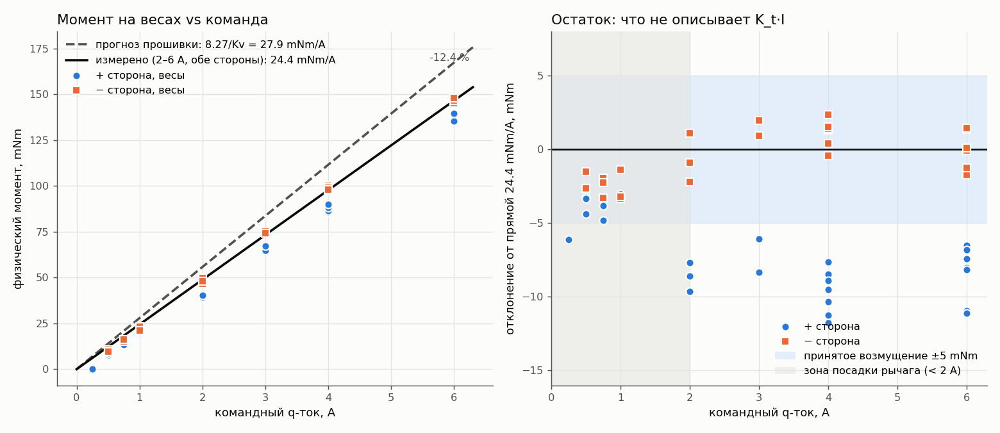

# Черновик: «Мотор отдаёт 87 % момента. Куда делись 13 %?»

Статус: черновик статьи / сценария видео. Не опубликовано.
Данные: [fixture spec §9–10](../hardware/motor-torque-fixture-spec.md),
[2026-10-26-torque-constant.json](../hardware/measurements/2026-10-26-torque-constant.json),
[PNDLM-9](https://zjor.youtrack.cloud/issue/PNDLM-9).
График: `figures/2026-10-26-torque-constant.png`
(строится `software/sim/app/plot_torque_constant.py`).

## 1. Зачем это вообще (хук)

Маховиковый перевёрнутый маятник держится на одном числе: сколько момента
мотор даёт на ампер. Прошивка драйвера moteus считает, что знает ответ:
K_t = 8.27 / Kv = 0.0279 Nm/A. Если число врёт на 10 %, симулятор врёт на
10 %, и обученная в нём сеть на реальном железе будет «толкать не так».
Поэтому перед любым обучением — измерить.

## 2. Как измеряли (сетап)

- Мотор mjbots mj5208, драйвер moteus r4.11, ротор удерживается рычагом.
- H-образный рычаг, плечо 105 мм, конец упирается в кухонные весы 0.1 г.
- Подаём постоянный q-ток 0.25…6 A по 3 с, читаем граммы. Обе стороны:
  весы переставляем под другой конец рычага и меняем знак тока.
- 7 запусков, 55 отсчётов, повторы сходятся в 1–3 г.
- Инструмент: `bench torque-constant`, интерактивный, с watchdog и
  стопами по скорости и смещению ротора.

Ключевая деталь: прошивка умеет отдавать момент в N·m, но мы фитим
физический момент с весов против **командного** тока, а не против того,
что прошивка «считает» моментом.

## 3. Что ожидали

Прямая τ = 0.0279·I без смещения. Контур тока отрабатывает команду за ~1 мс.

## 4. Что увидели (три сюрприза)

**Сюрприз 1: наклон меньше.** В зоне 2–6 A обе стороны дают
0.0244 ± 0.0005 Nm/A. Это 87.5 % прошивочного числа. Левая панель графика:
пунктир — прогноз, сплошная — реальность, расхождение −12.5 %.

**Сюрприз 2: «пропадает» 0.25 A.** Накануне казалось, что контур тока
недобирает: команда 1 A — измерено 0.73 A, и так на любом уровне. Версии:
медленный контур, ошибка датчика, недотянутый K_t. Разгадка оказалась в
конфиге: на контроллере включена компенсация зубцового момента
(anticogging). Таблица из 1024 точек добавляет к команде ток, зависящий от
угла ротора, — в позиции стенда −0.27 A. Проверка: на каждом плато разница
«измерено − команда» совпадает с интерполяцией таблицы с точностью 0.01 A,
включая дрейф при сжатии стенда под нагрузкой и смену знака, когда рычаг
сдвинулся на другой угол. Контур ничего не теряет. Он честно отдаёт
«команда + таблица».

**Сюрприз 3: ниже 2 A стороны расходятся.** Правая панель: после вычитания
прямой синие точки (плюс) сидят на −7…−11 mNm, оранжевые (минус) — около
нуля. Постоянная разница ≈ 9 mNm между сторонами, одинаковая на 3, 4 и 6 A.
Это не наклон и не радиус — наклоны совпадают в 0.3 %. Кандидаты:
гравитация на несимметричном H-рычаге (4.5 г лишних на одной ноге) или
остаток anticogging в этой точке. Разделять не стали: приняли худший случай,
возмущение ±5 mNm со стороны контроллера. Для маятника это 1.5 % от момента
удержания 20°.

## 5. Скорость отклика (бонус)

Первый замер «ступеньки» момента показал 95 % тока только через 23 мс. Но
ступенька подавалась из состояния stop, и 15 мс из них — служебная
последовательность включения прошивки (режимы 2 → 3 → 10). С предварительным
удержанием 0.01 Nm контур достигает цели к первому же отсчёту хоста,
4.4 мс при разрешении 2.6 мс. Для контроллера на 100–200 Гц момент можно
считать мгновенным. Вывод для прошивки хоста: никогда не выходить из
position mode между командами.

Это же объяснило загадку предыдущего эксперимента: 20-миллисекундные
импульсы «недобирали» 20–40 % тока, потому что три четверти импульса
уходили на включение.

## 6. Что это меняет в проекте

- Симулятор: момент = 0.875 × запрос, без смещения; или делим команду на
  0.875 в хосте.
- Ограничения скорости нарастания момента нет.
- Anticogging оставляем включённым: без него зубцовый момент до ±27 mNm с
  84 периодами на оборот. С ним — остаток ±5 mNm как возмущение.
- Gate Phase 0 проходит: 0.29 Nm непрерывно при 12 A, удержание 20° при
  13.5 A.

## 7. Чему научились о методе

- Фитить против **команды**, а не против показаний прошивки: прошивка
  оценивает момент через то же K_t, которое мы проверяем.
- Прежде чем искать физику в «недоборе», прочитать конфиг контроллера.
- Безопасность стенда: origin проверки смещения — на baseline каждого плато,
  иначе ручная посадка рычага между плато выглядит как убегание ротора.
- Останавливаться, когда главное число получено. Открытый вопрос (±5 mNm)
  записан как допущение, а не превращён в ещё три часа у стенда.

## 8. Открытые хвосты (в конец видео / статьи)

- Разделить гравитацию рычага и остаток anticogging: повторить 3/4/6 A с
  `motor.cogging_dq_scale 0`.
- K_t выше 6 A и в других позициях ротора.
- Тепловой предел: у mj5208 нет термистора.

## Заметки к видео

- Кадры: рычаг на весах, экран с обратным отсчётом плато, цифры на весах,
  tview с таблицей cogging.
- Монтажный ход: «пропавшие 0.25 A» как детектив, разгадка через конфиг.
- Один график на экране: левая панель, потом правая.
