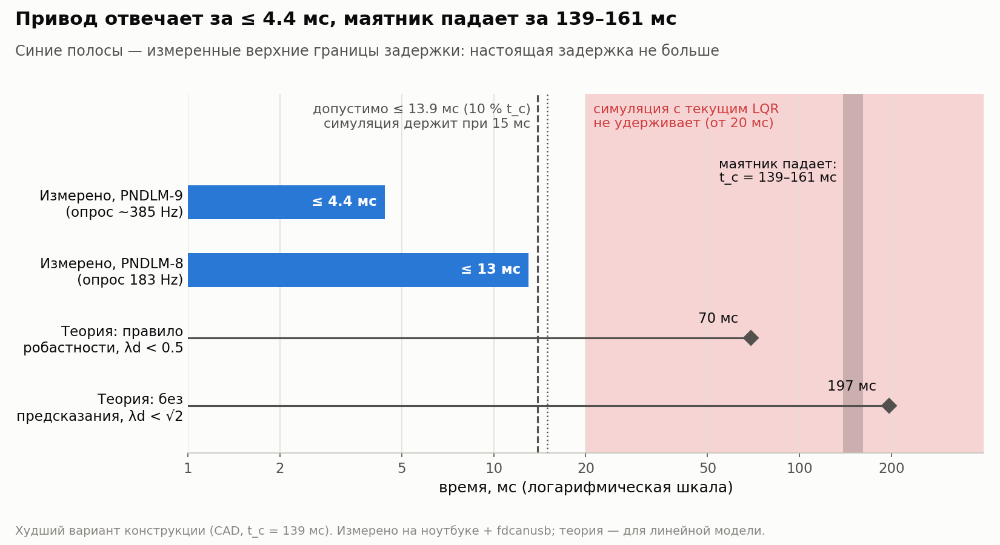
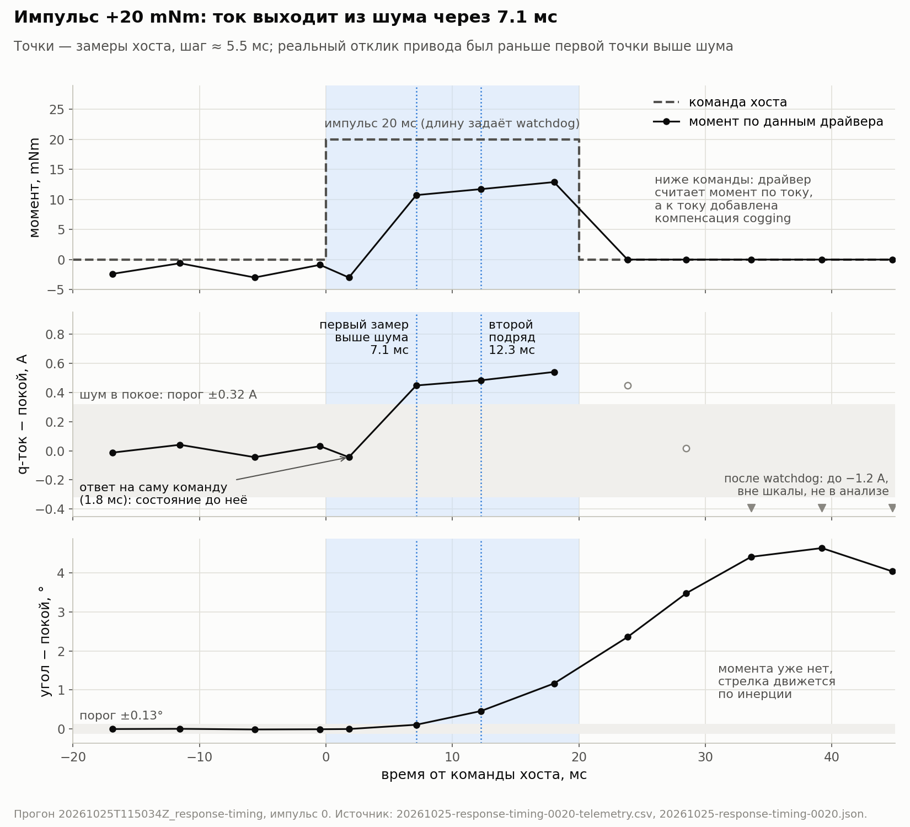

# Черновик: «Сколько миллисекунд есть у маятника»

Статус: черновик статьи. Не опубликовано. Площадка: не Telegram-пост
(длинный текст; Telegraph или блог — решить при публикации).
Данные: [отчёт о торк-импульсах](../hardware/desk-stand-torque-pulse-timing.md),
[спецификация опыта](../hardware/specs/response-timing.md),
[response-timing-0010.json](../hardware/measurements/20261025-response-timing-0010.json),
[0015](../hardware/measurements/20261025-response-timing-0015.json),
[0020](../hardware/measurements/20261025-response-timing-0020.json),
[допустимая задержка (Phase 0)](../physics/phase-0-feasibility.md#preliminary-sensor-timing-budget),
[PNDLM-8](https://zjor.youtrack.cloud/issue/PNDLM-8),
уточнение — [PNDLM-9](https://zjor.youtrack.cloud/issue/PNDLM-9)
([fixture spec §9.3–10](../hardware/specs/motor-torque-fixture.md)).
Числа конструкции: текущая модель масс из CAD, `poetry run phase0` в
`software/sim` (2026-11-08).
Графики: `figures/2026-11-08-response-delay-pulse.png` (A),
`figures/2026-11-08-response-delay-scale.png` (B); строит
`software/sim/app/plot_response_delay.py` (команды — в docstring скрипта).

## 0. Аннотация

Перевёрнутый маятник без управления падает. Отклонение растёт примерно в
2.7 раза каждые 139–161 мс. Регулятор должен успеть заметить наклон и
подать управляющий момент на маховик раньше.

Вопрос этой статьи: сколько времени проходит от команды компьютера до момента на валу мотора?

Ответ: не больше 13 мс, а уточнённый опыт дал не больше 4.4 мс. Этого хватает с запасом.

## 1. Вход: что у нас было

- Мотор mjbots mj5208, драйвер moteus r4.11.
- Хост — ноутбук. Скрипт на Python шлёт команды через USB-адаптер
  fdcanusb в шину CAN-FD.
- На валу — лёгкая стрелка вместо маховика. Стенд стоит на столе.
- Расчёт Phase 0. Phase 0 — первый этап проекта: до сборки железа
  проверить расчётом и симуляцией, что выбранные мотор и драйвер вообще
  могут удержать маятник. Из него:
  - характерное время падения t_c. Это время, за которое наклон маятника
    без управления растёт в e ≈ 2.7 раза. По модели масс из CAD:
    161 мс номинально, 139 мс в худшем варианте конструкции;
  - допустимая задержка контура ≤ 13.9 мс (10 % от худшего t_c) и частота
    опроса ≥ 144 Hz. Это требования к контуру управления, принятые с
    запасом: регулятор должен реагировать намного быстрее, чем падает
    маятник;
  - симуляция с LQR и реальными пределами мотора удерживает маятник при
    задержке 15 мс и не удерживает при 20 мс.

Чего не было: измеренной задержки самого привода.

## 2. Мотивация: почему задержка важна

Линейная модель маятника около вертикали:

$$
I_p\,\ddot\theta = G\,\theta - u, \qquad
\lambda = \sqrt{G/I_p}, \qquad t_c = 1/\lambda .
$$

- θ — угол от вертикали, u — момент маховика.
- G — гравитационный момент: G = m·g·l_c, масса маятника × g × расстояние
  от оси до центра масс. При наклоне θ сила тяжести опрокидывает маятник
  моментом G·sin θ. По CAD G = 1.11 Nm.
- I_p — момент инерции маятника вокруг оси, 0.0289 kg m².
- λ — скорость роста наклона. Без управления наклон растёт как e^{λt}.
  Чем больше λ, тем быстрее падает маятник. По CAD λ ≈ 6.2 1/s, в худшем
  варианте 7.2 1/s.
- t_c = 1/λ — то же самое, выраженное как время: 161 мс и 139 мс.

Где модели можно верить. Модель заменяет sin θ на θ. Ошибка этой замены:
0.5 % при 10°, 2 % при 20°, 4.7 % при 30°. Наши рабочие углы — до 10°
(толчок пальцем) и до 20° (желаемый запас), там модель точна. Ещё модель
не знает о пределе момента мотора; его учитывает симуляция.

- Регулятор видит угол, вычисляет команду, команда идёт по шине, драйвер
  выставляет ток. Всё это время маятник продолжает падать.
- Если в симуляторе задержки нет, регулятор и нейросеть обучатся на
  нереально быстром приводе. На железе такой контроллер может не
  удержать маятник.

Цель опыта: получить честное число задержки для симулятора.

## 3. Что сделали

**Идея опыта.** Привод включён, момент ноль, стрелка стоит. Хост даёт
один короткий импульс момента и дальше только читает телеметрию.

Даже когда команд нет и стрелка стоит, датчики не показывают ровные нули.
Ток, угол и скорость немного колеблются: это шум измерения. Поэтому перед
каждым импульсом хост записывает этот шум в покое. Отклик — это первый
замер, где сигнал вышел заметно за пределы этого шума.

- Импульсы ±0.01, ±0.015, ±0.02 Nm длиной 20 мс, по 4 на уровень.
- Команда момента — feedforward torque при нулевых коэффициентах
  регулятора положения. Регулятор положения не участвует.
- Импульс выключает watchdog драйвера. Watchdog — таймер внутри драйвера.
  Если новая команда не пришла за заданное время (здесь 20 мс), драйвер
  сам снимает момент. Обычно это защита: если хост завис, мотор не
  продолжает крутить. Здесь он ещё и задаёт точную длину импульса одной
  командой, без второй команды «стоп».
- Перед каждым импульсом хост ждёт, пока стрелка успокоится: скорость
  ≤ 0.03 rev/s, разброс угла ≤ 0.0005 rev.
- Защита стенда: стоп по скорости и ходу, проверка ошибок связи. В
  драйвер ничего не пишется во flash.
- Хост опрашивает драйвер с частотой 182–183 Hz (запрос 200 Hz), то есть
  раз в ~5.5 мс.

**Как определяем отклик.** Для каждого сигнала отдельно: порог = 2 ×
максимальное отклонение шума в покое (не меньше 0.05 A, 0.1°,
0.02 rev/s). «Первый отклик» — первый замер выше порога.
«Подтверждение» — второй замер подряд выше порога с тем же знаком; он
отсекает случайный выброс шума.

**Примечание: ошибки в инструменте.** Четыре дефекта стендового скрипта
нашлись только на железе: первое открытие транспорта занимает ~80 мс;
`conf get` отвечает без `OK`, и библиотека ждала вечно; новый поток
теряет первый ответ; ответ на `stop` сообщает старый режим. Все
исправлены и покрыты тестами.

## 4. Что измерили

| Импульс | Прогон | Первый отклик (ток / угол) | Подтверждение | Пик скорости |
|---|---|---|---|---|
| ±0.01 Nm | `20261025T113416Z` | не виден / 12.1–12.5 мс | 17.5–18.8 мс | 0.25 rev/s |
| ±0.015 Nm | `20261025T114422Z` | 6.7–12.9 / 12.2–12.9 мс | 17.6–18.1 мс | 0.45 rev/s |
| ±0.02 Nm | `20261025T115034Z` | 7.1–12.7 / 7.4–12.9 мс | 17.5–19.1 мс | 0.62 rev/s |

Как читать таблицу:

- Все значения около 7 мс или около 12–13 мс. Это первый и второй замер
  после команды. Других значений быть не может: хост смотрит раз в 5.5 мс.
- Реальный отклик привода случился **до** этого замера. Значит, 13 мс —
  верхняя граница задержки, а не сама задержка. Вероятно, задержка ≤ 7 мс.
- На каком замере виден сигнал, зависит от силы импульса. При 0.01 Nm ток
  ни разу не прошёл порог: шум тока в покое 0.22–0.31 A.
- Связь: CAN round trip медиана 1.9–2.0 мс, p99 2.7–3.2 мс, редкие
  выбросы до 15.8 мс.

Точность ограничена частотой опроса хоста, а не приводом. Больше
импульсов её не улучшат. Нужен более частый опрос.

## 5. Дополнительные вопросы

**Где здесь хост и будет ли так же на устройстве?** Хост — ноутбук с USB.
Число описывает цепочку «ноутбук → fdcanusb → moteus». На маятнике будет
Raspberry Pi + pi3hat без USB. Задержку там нужно измерить заново.

**Можно ли опрашивать чаще?** Да. 200 Hz — настройка, а не предел. В
следующей задаче (PNDLM-9) на том же ноутбуке получили разрешение 2.6 мс
(~385 Hz): момент дошёл до 95 % уже к первому замеру, через 4.4 мс. Для
pi3hat производитель обещает контур ≥ 1 kHz; мы это пока не проверяли.

**Почему положительные импульсы дали меньше тока, чем отрицательные?**
Команда 0.02 Nm означает ~0.72 A. К третьему замеру (≈18 мс) ток вырос на
−0.72…−0.73 A у отрицательных импульсов, но только на +0.52…+0.53 A у
положительных.
- Версия «драйвер включался из stop» не подходит. В PNDLM-9 нашли, что
  включение из stop занимает ~15 мс. Но здесь привод перед каждым
  импульсом уже был включён (mode 10).
- Объяснение — компенсация cogging. Cogging — момент «залипания» ротора:
  магниты ротора притягиваются к зубцам статора. Если крутить вал рукой,
  чувствуются мелкие щелчки. У mj5208 это до ±27 mNm, 84 периода на
  оборот. Драйвер гасит его: добавляет к команде ток из калиброванной
  таблицы, свой для каждого положения ротора (от −1.12 до +0.90 A).
  Поэтому измеренный ток = команда + табличная поправка.
- За импульс ротор поворачивается на 0.6–1.2°, и поправка меняется вместе
  с ним. Положительный и отрицательный импульсы сдвигают ротор в разные
  стороны, поэтому поправка меняется с разным знаком. Если вычесть её,
  получается +0.63…+0.69 и −0.60…−0.69 A: асимметрия пропадает.
  Остаток 0.03–0.12 A меньше шума тока в покое (0.12–0.16 A).
- Та же таблица объясняет ещё одну загадку: ток −0.00…−0.09 A при нулевой
  команде. Это поправка anticogging в точке, где стоит ротор.
- Оговорка: как драйвер выбирает строку таблицы по положению ротора, мы
  предположили. Предположение подтверждается совпадением тока в покое,
  но по коду прошивки не проверено.
- Отдельно: реальный K_t на 12.5 % ниже прошивки (PNDLM-9). Это влияет на
  момент, но не на ток.

**Какая задержка допустима в теории?** Оценки для линейной модели, худший
вариант конструкции (λ ≈ 7.2 1/s):
- обратная связь по состоянию без предсказания: λ·d < √2 → d < 197 мс;
- практическое правило робастности (Skogestad): λ·d < 0.5 → d < 70 мс;
- допустимая задержка по требованиям проекта: 10 % от t_c → 13.9 мс;
- наша симуляция: удерживает при 15 мс, не удерживает при 20 мс.

Что значит «не удерживает». Симуляция стартует с наклона 10° и длится
5 с. Проверка пройдена, если за последнюю секунду наклон ≤ 2° и
маховик крутится не быстрее 100 rpm. При 20 мс это условие не
выполняется.

Почему так рано, если теория допускает 70 мс? Коэффициенты текущего LQR
рассчитаны по непрерывной модели. Она предполагает, что регулятор видит
состояние постоянно и действует мгновенно: в ней нет ни шага опроса, ни
задержки. В симуляции регулятор работает дискретно и с задержкой, а
сверху ещё предел момента и шум. Дискретный LQR с учётом задержки
(прошлые команды входят в состояние, и регулятор фактически предсказывает
положение маятника на момент действия команды) должен выдержать больше.
Это не проверено.

**Побочное.** Скорость, которую сообщает драйвер, шумит (±0.025 rev/s в
покое) и отстаёт на ~6 мс. Угол чистый (0.0001 rev). Оценка состояния не должна учитывать скорость драйвера как есть.

## 6. Результат и что это значит для проекта

- **В симулятор:** задержка команды момента 5 мс номинально, 10 мс
  пессимистично.
- **Запас.** Граница 13 мс на 0.9 мс ниже допустимой задержки 13.9 мс и
  на 2 мс ниже предела симуляции (15 мс). На грани. Уточнение PNDLM-9
  (≤ 4.4 мс) даёт нормальный запас.
- **Вердикт:** задержка привода не блокирует проект.
- **Правило для контроллера:** держать привод всё время включённым.
  Включение из stop стоит ~15 мс.
- **Дальше:**
  - дискретный LQR с учётом задержки — узнать реальный предел;
  - задержка в RL-среде: очередь действий, история действий в наблюдении,
    случайная задержка по эпизодам;
  - повторить этот опыт на Raspberry Pi + pi3hat.

## Графики

- **A. Один импульс во времени** (`figures/2026-11-08-response-delay-pulse.png`).
  Прогон `20261025T115034Z`, импульс 0 (+20 mNm). Три панели: момент
  (команда и данные драйвера), q-ток и угол относительно покоя, с порогами
  шума. Точки — замеры хоста. Подписи объясняют ответ на саму команду
  (состояние до неё), момент ниже команды (компенсация cogging) и
  движение стрелки после импульса. Данные:
  [20261025-response-timing-0020-telemetry.csv](../hardware/measurements/20261025-response-timing-0020-telemetry.csv)
  (выборка столбцов из сырого лога, все 330 строк) и
  [20261025-response-timing-0020.json](../hardware/measurements/20261025-response-timing-0020.json)
  (пороги, времена отклика, SHA-256 сырого лога).
- **B. Шкала задержек** (`figures/2026-11-08-response-delay-scale.png`).
  Логарифмическая ось времени. Синие полосы — измеренные верхние границы
  4.4 (PNDLM-9) и 13 мс (PNDLM-8). Вертикальные линии — допустимая
  задержка 13.9 мс и предел симуляции 15 мс; красная зона — симуляция не
  удерживает (от 20 мс); тёмная полоса — t_c 139–161 мс; ромбы — теория,
  70 и 197 мс. Главный график статьи.
